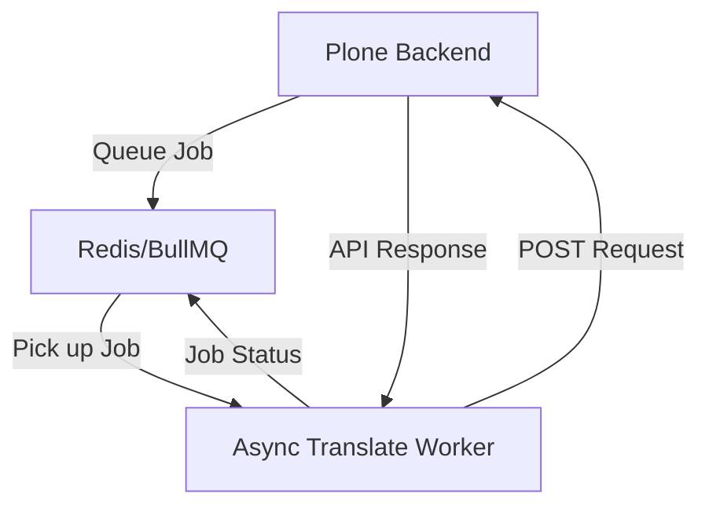

# Climate-ADAPT Async Translate Microservice

This microservice is a Node.js-based worker that manages the asynchronous translation workflow for Climate-ADAPT. It uses [BullMQ](https://bullmq.io/) and Redis to handle job queuing and state management.

## Role in the Ecosystem

The service acts as a middleware/orchestrator between the Plone backend and the external eTranslation service. Its primary purpose is to decouple long-running translation tasks from the main CMS operations, ensuring a responsive user experience.

## Tech Stack

- **Core**: Node.js, TypeScript
- **Queue Management**: BullMQ, IORedis
- **Web Framework**: Fastify
- **Communication**: node-fetch (interacting with Plone API)
- **Monitoring**: BullBoard, QueueDash

## Architecture

The service operates as a worker, picking up jobs from Redis and executing them by calling specific API views in Plone.

## Key Jobs and Workflow

The service handles three main types of jobs, defined in `src/jobs.ts`:

### 1. `call_etranslation`
- **Triggered by**: Plone when content needs translation.
- **Action**: Calls Plone's `@@call-etranslation` view.
- **Goal**: Triggers the actual SOAP call from Plone to the EC's eTranslation service.

### 2. `save_translated_html`
- **Triggered by**: Plone's `@@translate-callback` (after receiving content from EC).
- **Action**: Calls Plone's `@@save-etranslation` view.
- **Goal**: Ingests the translated HTML back into the Plone content types (converting it back to Volto blocks if necessary).

### 3. `sync_translated_paths`
- **Triggered by**: Plone when a canonical object is moved or renamed.
- **Action**: Calls Plone's `@@sync-translated-paths` view.
- **Goal**: Ensures that all translation objects are moved to the corresponding new paths.

### 4. `delete_translation`
- **Triggered by**: Plone when a canonical object is deleted.
- **Action**: Calls Plone's `@@delete-translation` view.
- **Goal**: Safely removes all linked translation objects by UID.

### 5. `submit_group`
- **Triggered by**: this service, when `ETL_GROUPING_ENABLED=true`.
- **Action**: Submits one bundled eTranslation request for every language that
  was collected for an object during the grouping window.
- **Goal**: Turn 26 per-language submissions into one, and keep the number of
  concurrent in-flight submissions under eTranslation's quota. See
  [Quota-aware submissions](#quota-aware-submissions).

### 6. `translation_failed`
- **Triggered by**: Plone's `@@translate-failure` view, which receives
  eTranslation's failure notification.
- **Action**: Resolves the submission from its `externalReference` and releases
  the in-flight share of each named language.
- **Goal**: A language that fails upstream used to be invisible - the delivery
  simply never arrived and the submission slot was held until the lease expired.
  This turns that silence into an event. See
  [`ETRANSLATION-FAILURE-NOTIFICATIONS.md`](../../artifacts/ETRANSLATION-FAILURE-NOTIFICATIONS.md).

## Queues

The service monitors the following queues by default (configurable via `BULL_QUEUE_NAMES_CSV`):

- **`etranslation`**: Used for `call_etranslation` jobs.
- **`save_etranslation`**: Used for `save_translated_html` jobs.
- **`sync_paths`**: Used for `sync_translated_paths` jobs.
- **`delete_translation`**: Used for `delete_translation` jobs.
- **`etranslation_submit`**: Used for `submit_group` jobs (grouping mode only).

## Quota-aware submissions

eTranslation enforces a **concurrency quota of 50 active submissions per client**
and answers anything above it with HTTP 400 / `errorCode=-11200 QUOTA_EXCEEDED`,
[continuing to reject](https://language-tools.ec.europa.eu/dev-corner/etranslation/rest-v2/rate-limits)
until the number of in-flight submissions falls back below the quota. "Active"
means submitted-but-not-yet-delivered, so a worker that submits faster than the
service delivers blows the budget in seconds. See
[`../../artifacts/ETRANSLATION-QUOTA-ANALYSIS.md`](../../artifacts/ETRANSLATION-QUOTA-ANALYSIS.md)
for the production evidence.

Three mechanisms address it, all off by default:

| Mechanism | Where | Effect |
|---|---|---|
| **Grouping** | `call_etranslation` collector + `submit_group` | Plone queues one job per language; the collector folds them into one group and issues a single request with a `targetLanguages` array. A multi-language request counts as **one** active submission, so this is a 26x reduction. |
| **In-flight gate** | `QuotaStore` (`cca:inflight:idx`) | A zset of submission leases. A slot is taken on submit, released when the last language is delivered, and always reclaimed when the lease expires - eTranslation can drop a language without reporting a failure. A `-11200` opens a circuit breaker and requeues instead of failing the job. |
| **Skip-unchanged cache** | `QuotaStore` (`cca:done:<sha>`) | Languages already translated for byte-identical source HTML are not re-submitted. |

The `externalReference` sent to eTranslation is a short correlation id
(`cca-<10 hex chars>`, 14 characters) rather than the full object path, which
reached 210 characters on deep paths and was rejected with
`errorCode=-10003 CALLER_INFORMATION_EXTERNAL_REFERENCE_TOO_LONG` (schema limit
200). The correlation record maps the id back to path / serial_id / obj_uid.

### Deployment precondition

**`ETL_GROUPING_ENABLED` must stay `false` until the matching Plone change is
live.** A bundled request has one `externalReference` shared by every
per-language delivery, so the language can only come from the callback payload.
The required Plone changes are:

1. `@@call-etranslation` accepts a comma separated `target_lang` and an optional
   `ext_ref`.
2. `@@translate-callback` forwards `targetLanguage` as `language` in the queued
   `save_translated_html` payload.

If a bundled delivery arrives without a language the save handler throws rather
than guessing - guessing would write one language's text into another. A
legacy-shaped reference that carries no `language` is refused for the same
reason.

State lives in Redis under `cca:*` and every key carries a TTL. Inspect it with
`redis-cli KEYS 'cca:*'`, or read `GET /stats` for `inFlight`, `breakerOpen` and
counters.

### Failure notifications
eTranslation only reports a failed language when the request asks for it via
`notifications.failure.http`. Plone now sets that to `@@translate-failure`, which
queues a `translation_failed` job. Without it a failing language produces no
signal at all - which is why EN->ET once vanished from a 26-language submission
with no error anywhere in the logs.

**Deploy the worker before the Plone change.** Plone is what starts sending the
notifications; if `translation_failed` is missing from `ENABLED_JOBS` the worker
rejects the job with `RateLimitError` and retries it immediately - a busy loop.
With failure notifications confirmed working, `ETL_LEASE_MS` can drop from 15
minutes to 2-3, because a submission is then resolved by an event rather than by
a timeout.

## Monitoring and UI

The service provides two interfaces for monitoring:

- **BullBoard**: Accessible at `/ui`. Provides a detailed view of queues, job statuses, and allows for retrying failed jobs.
- **QueueDash**: Accessible at `/dash`. Provides a dashboard-style overview of the queues.

## Configuration (Environment Variables)

- `PORT`: Port for the web server (default: 3000).
- `REDIS_HOST`, `REDIS_PORT`: Connection details for Redis.
- `PORTAL_URL`: The base URL of the Plone backend (e.g., `http://localhost:8080/cca`).
- `TRANSLATION_AUTH_TOKEN`: Shared secret for authenticating with Plone.
- `ENABLED_JOBS`: Comma-separated list of jobs this worker should process.
- `BULL_QUEUE_NAMES_CSV`: Comma-separated list of queues to monitor.
- `ETL_*`: Quota-aware submission tuning. See `env.example` for every knob and
  its default; the important ones are `ETL_GROUPING_ENABLED`, `ETL_MAX_INFLIGHT`
  and `ETL_LEASE_MS`.

## Development

- **Build**: `npm run build` (uses `tsc`)
- **Start**: `npm start` (uses `nodemon` and `ts-node`)
- **Lint**: `npm run lint`
- **Test**: `npm test` (vitest). Tests drive `QuotaStore` and the job handlers
  against `test/fake-redis.ts`, an in-memory Redis double with an injectable
  clock so lease expiry is deterministic. No network and no real Redis needed.
- **Smoke test**: run a throwaway Redis, start the service against it, queue
  jobs with a small bullmq script, then read `GET /stats`.
